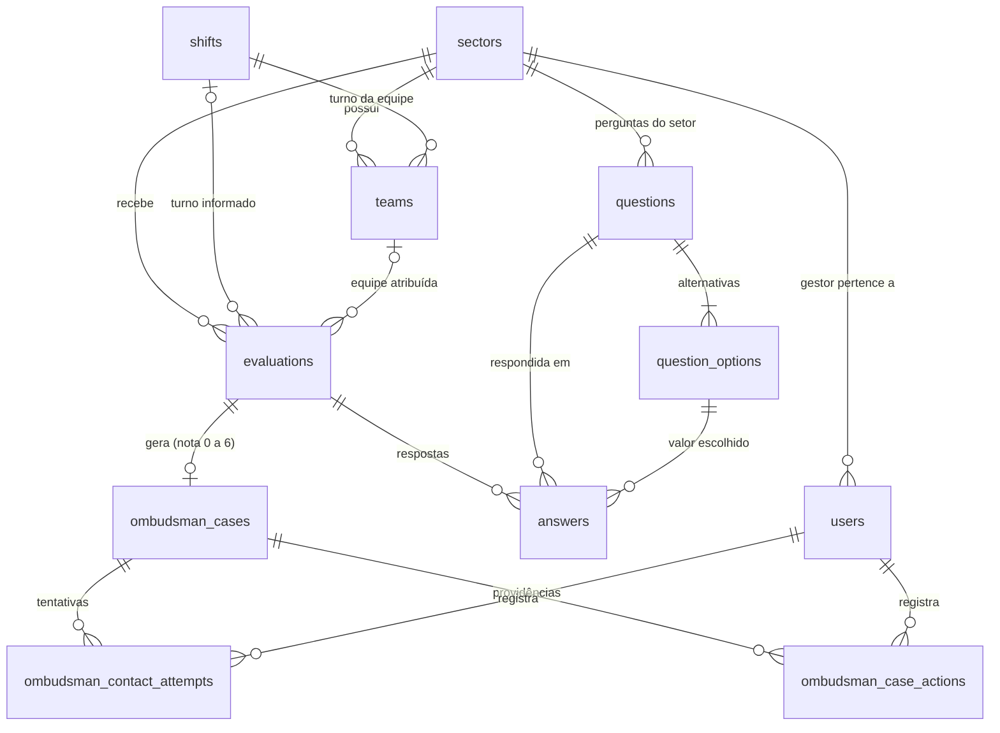

# Modelo de dados (Etapa 3)

PostgreSQL no Supabase. As tabelas ficam no schema `public`, são criadas por migrações SQL em
`backend/migrations/` e acessadas **somente pelo backend** (a API automática do Supabase fica fechada por RLS).

## Diagrama

## Tabelas

| Tabela | Papel |
|---|---|
| `sectors` | Setores; o `slug` forma a URL pública `/pesquisa/:slug`; `is_active` fecha/reabre a pesquisa do setor |
| `shifts` | Turnos cadastrados (nome + horário; fim menor que início = atravessa a meia-noite) |
| `teams` | Equipes (A/B...) de um setor, ligadas a um turno |
| `users` | Usuários internos: `super_admin`, `gestor` (com setor) e `ouvidoria`; só `password_hash`; `must_change_password`; `token_version` (derruba sessões ao trocar a senha ou desativar) |
| `questions` | Perguntas de setor e a pergunta de NPS (`is_nps`, sem setor); obrigatória/opcional, ativa/inativa, ordem |
| `question_options` | Alternativas de cada pergunta (valor 0–10 + rótulo opcional): escala 1–5 ou NPS 0–10 |
| `evaluations` | Uma avaliação por respondente anônimo: setor, data/hora/turno, equipe, estado, nota de NPS, hash do token |
| `answers` | Uma linha por pergunta de cada avaliação (valor ou "pulada") |
| `ombudsman_cases` | Atendimento criado a partir do feedback: código, tipo, texto, contato/consentimento, situação e encerramento |
| `ombudsman_contact_attempts` | Tentativas de contato (numeradas pelo banco), resultado e interesse em continuar |
| `ombudsman_case_actions` | Providências e andamento do atendimento |

Os feedbacks e os atendimentos ficam na **mesma tabela** (`ombudsman_cases`), já que cada feedback gera
exatamente um atendimento. O NPS não tem tabela própria: é uma pergunta (`is_nps`) respondida em `answers`.

## Regras garantidas pelo próprio banco

| Regra | Como é garantida |
|---|---|
| Senha nunca em texto puro | `users.password_hash` só aceita formato de hash argon2/bcrypt (CHECK) |
| Gestor sempre tem setor; outros perfis não | CHECK em `users` |
| Só uma pergunta de NPS ativa; NPS é global | Índice único parcial + CHECK em `questions` |
| Pergunta com respostas não é apagada, só desativada | `answers` → `questions` e → `question_options` com `ON DELETE RESTRICT`; não muda de setor/tipo com respostas |
| Resposta salva individualmente; corrigir = substituir | PK `(evaluation_id, question_id)` + `INSERT ... ON CONFLICT DO UPDATE`; respostas nunca são apagadas |
| Valor respondido é uma alternativa da pergunta | FK composta `(question_id, value)` |
| Obrigatória e NPS não podem ser puladas; pergunta do setor certo e ativa | Gatilho `answers_guard` |
| Avaliação incompleta x completa; só completa com NPS | `status` + CHECKs em `evaluations` |
| Avaliação finalizada é imutável; nada é excluído | Gatilhos de `evaluations` e `answers`. Única exceção: definir a equipe quando ainda não havia (ver abaixo) |
| Horário **ou** turno informado; equipe do mesmo setor | CHECK + FK composta `(team_id, sector_id)` |
| `evaluations.nps_score` sempre igual à resposta de NPS | Gatilho `answers_sync_nps` |
| Feedback só para nota 0–6; código próprio e único | Gatilho + sequência (`OUV-AAAA-NNNNNN`) |
| Retorno pedido ⇒ celular + consentimento; anônimo ⇒ nenhum dos dois | CHECK `ombudsman_cases_contact_consistency` |
| Atendimento encerrado não reabre nem recebe novos registros | Gatilhos em `ombudsman_*` |
| Histórico de tentativas e providências é só de inclusão | Gatilhos `forbid_update_delete` |
| Conteúdo original do feedback não muda | Gatilho `ombudsman_cases_guard_update` |
| Banco fechado para a API pública do Supabase | RLS ativado sem políticas + privilégios de `anon`/`authenticated` retirados |

## O que continua nas regras do backend (próximas etapas)

- Contar três tentativas sem resposta e encerrar como "contato sem sucesso" (o banco guarda tentativas e encerramento, mas não decide).
- Escolher o turno a partir do horário.
- Atribuir a equipe. A regra para distinguir equipes do mesmo setor e turno (provavelmente dia da semana ou escala de revezamento) **fica em aberto para o Super Admin definir**. Até lá, `evaluations.team_id` fica nulo quando houver mais de uma equipe possível, em vez de atribuir arbitrariamente. Quando a regra existir, ela poderá preencher a equipe também das avaliações já finalizadas (única alteração permitida em avaliação finalizada, e só se ainda não houver equipe).
- Validar a obrigatoriedade das perguntas ao avançar e a autorização por perfil/setor.
- Gerar o token da avaliação e gravar apenas o seu SHA-256.
- Calcular NPS e indicadores; atualização dos dashboards a cada 8 horas.

## Fora desta etapa

Tabela de configurações (link do texto legal), a configuração da regra de atribuição de equipe pelo Super Admin, snapshots dos dashboards e a criação do primeiro Super Admin (virá com a autenticação, que gera o hash da senha).
